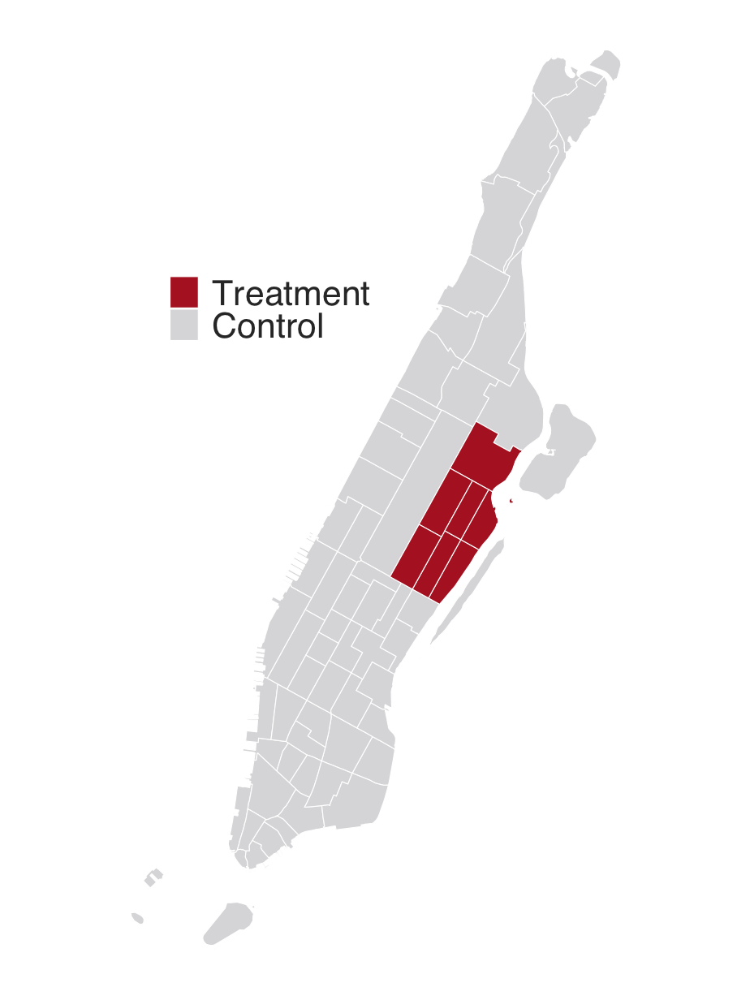
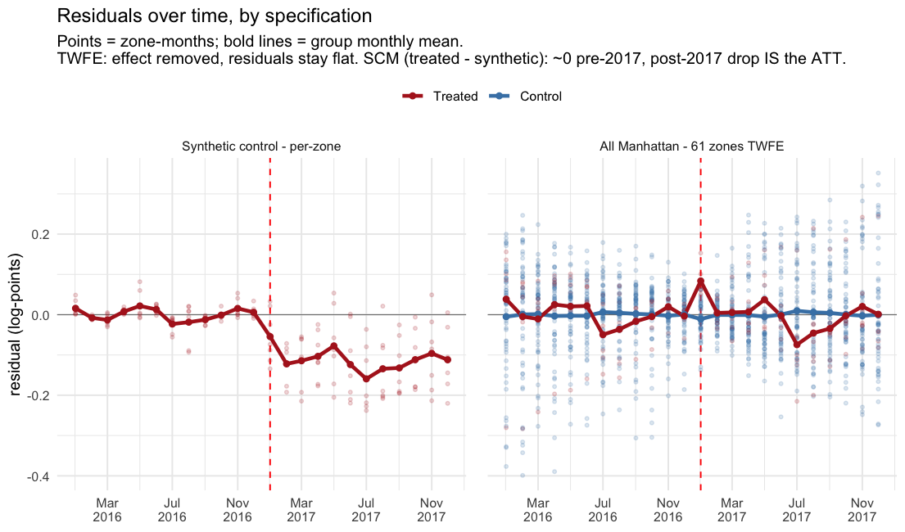
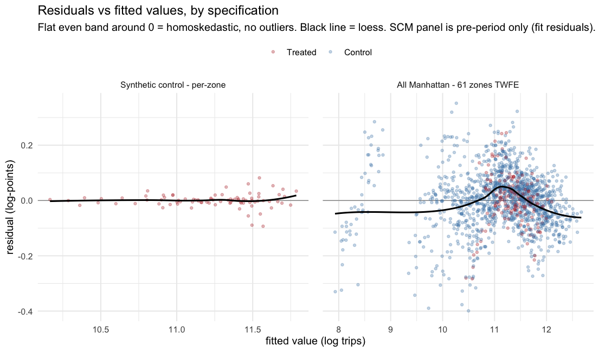

# How did the new Second Avenue Subway impact ride-hailing in NYC?

**A difference-in-differences study of the Q line extension's effect on Uber/Lyft trips in Manhattan, 2016–2017.**

This study measures how an extraordinary intervention into New York City's public
transportation system—the introduction of the Second Avenue Subway on January 1st 2017—shifted
mobility behavior. A 2018 study by the NYC Department of Transportation found that the subway
created major changes:

- **82%** of the new subway's riders switched from the Lexington Avenue line, which by 2007 had
  become the most crowded subway line in America.
- Yellow-taxi demand fell 11% citywide but **36%** in areas neighboring new stations.
- Southbound driving speeds rose on Second and Lexington Avenues (compared to First and Third
  Avenues), relieving Manhattan congestion delays that the Mayor's office appraised at **$14.7
  billion** in 2016.

The Department of Transportation documented these shifts descriptively but never estimated the
causal effect on ridehailing. This study aims to fill the gap, and contribute to a broader
literature about the impact of transit interventions.

**Why this matters:** Cities spend billions on rail partly to pull trips off congested streets;
the Second Avenue Subway was the world's most expensive per-mile transit project. Yet
whether ridehailing substitutes or complements transit remains unsettled and highly local. The
answer shapes congestion pricing, emissions, and how the next transit project is justified.

**Headline result:** Ridehailing in treated areas declined ~10% compared to multiple control
groups tested in this study. The effect is robust to multiple model specifications and
treatment/control group selections. Across comparison groups, the decline spans 7–13%, and 10%
is the midpoint — i.e., **roughly 1 million fewer ridehailing trips in 2017 alone.**

**The story in one chart**

<p align="center">
  
</p>

## Research Design

Ride-hailing grew rapidly across New York in 2016 and 2017, so a rise in trips near the new
line says little on its own; what matters is how demand changed relative to the rest of the
city. Using monthly ride-hailing trip counts for every Manhattan neighborhood over 2016–2017,
I treat the seven zones along the new line (the Upper East Side and Yorkville corridor) as the
treatment group and the remaining Manhattan zones as controls. A difference-in-differences
design then isolates the change in treated-zone demand after January 2017, net of the city-wide
trend. Because the line opened in all treated zones at once, the design avoids the
staggered-adoption problems (Goodman-Bacon; de Chaisemartin and D'Haultfœuille) that complicate
many recent DiD studies.

<p align="center">
  
</p>

## Headline results

| Estimator | Effect | Notes |
|---|---:|---|
| **Synthetic control, per-zone average (preferred)** | **−10.6%** | bespoke synthetic twin per zone, averaged; pooled permutation *p* = 0.003 |
| Two-way fixed-effects DiD (61-zone main) | −13.2% | cluster-robust SE 0.055; wild-cluster *p* ≈ 0.06 with only 7 treated zones |
| TWFE + group-specific linear trend | −9.0% | shrinks but survives |
| Drop month of opening (Dec '16 / Jan '17) | −13.2% / −14.0% | insensitive to the transition month |
| Synthetic control, pooled | −7.0% | conservative floor |
| HonestDiD (relative-magnitudes) | [−21%, −6.7%] at Mbar = 0 | breakdown Mbar ≈ 0.2 — the robust CI admits zero once allowed trend violations reach a quarter of the largest pre-period deviation; a fragility check, not corroboration |

**Honest range: −7% to −13%, central estimate ≈ −10%** — a robust direction, held with moderate
rather than overwhelming statistical confidence (see [Residual & inference diagnostics](#residual--inference-diagnostics)).

**Which number to cite for significance:** the synthetic-control permutation (raw-gap *p* = 0.003) — it
matches the per-zone-average estimand and treats the contiguous corridor as a single object rather than
seven independent clusters; the TWFE wild-cluster bootstrap (*p* ≈ 0.06) corroborates it, and the
pre-fit-normalized SCM tests (*p* ≈ 0.11) are the conservative floor.

**Why these estimators, and why synthetic control leads.** No single number is trusted on its
own — the design triangulates across methods whose assumptions fail in different ways. The
two-way fixed-effects DiD is the conventional workhorse: it absorbs each zone's fixed level and
each month's city-wide shock, which is exactly why it is the right estimator here (subway
proximity is correlated with time-invariant zone traits like income and density, so a
random-effects model would be biased). But it buys identification with a *parallel-trends
assumption* — that the treated corridor would have grown like the Manhattan average absent the
subway. That assumption is untestable after 2017, and the HonestDiD bounds show the −13% TWFE
point estimate sits at the pessimistic edge of what the pre-trends can actually support.

The synthetic control is preferred because it replaces that assumption with a *fit*. Rather than
compare the corridor to the raw control average, it builds a weighted blend of control zones that
reproduces the corridor's 2016 trajectory almost exactly (RMSPE ≈ 0.003) — so the counterfactual
demonstrably tracked the treated group before the line opened, instead of being assumed to. The
per-zone version fits a bespoke synthetic twin for each of the seven treated zones and then
averages, which also respects the fact that those zones differ in income, density, and baseline
ride-hailing levels. Its −10.6% estimate lands between the conservative pooled-synthetic floor
(−7%) and the TWFE upper edge (−13%), which is why it anchors the headline.

### Parallel trends and the event study

The pre-period carries no linear trend (slope +0.002 log-pts/mo, *p* = 0.49) and only two of eleven
pre-period coefficients individually clear zero; a joint test nonetheless rejects perfect flatness
(*F* = 6.25), reflecting month-to-month wiggle rather than a trend — which is why the effect is bounded
with HonestDiD rather than rested on an eyeballed parallel-trends claim. Every post-period month is
negative, and the full drop arrives in the first month (−0.13 in January 2017, with no gradual ramp) —
the sharp onset of a supply shock, not a slowly diverging trend.

<p align="center">
  
</p>

## Robustness suite

Every check lives in a numbered, runnable script under [`analysis/`](analysis/).

| Check | Script | What it probes |
|---|---|---|
| Main DiD (two-way FE, 61 zones) | `05_did_main_61zones.R` | the headline effect |
| Full model suite (OLS / FE / event study / spatial error models) | `06_models_full_suite.R` | specification and spatial-error sensitivity |
| Pre-trends & parallel-trends diagnostics | `07_pretrends.R` | event study, group trends, month drops |
| HonestDiD (Rambachan–Roth 2023) | `08_honest_did.R` | sensitivity to parallel-trends violations (relative-magnitudes & smoothness) |
| Synthetic control (Abadie, via CVXR) | `09_synthetic_control.R` | design-based counterfactual, pooled and per-zone; placebo/permutation inference and leave-one-out |
| Pooled synthetic-control inference (Cavallo 2013; Dube–Zipperer 2015) | `14_pooled_scm_inference.R` | permutation test on the per-zone-average effect — the estimand that matches the headline |
| Spatial spillover (donut / Butts 2023 ring / SLX) | `10_spatial_spillover.R` | SUTVA / interference from neighboring control zones |
| Hausman / FE-vs-RE (Mundlak-Wu) | `11_hausman.R` | estimator choice, with the degenerate-Hausman explained |
| 52-zone contiguous subset | `12_did_robustness_52zones.R` | a tighter, fully-contiguous spatial subsample |
| Residual diagnostics & honest inference | `13_residual_diagnostics.R` | residuals across the two headline estimators, plus serial-correlation tests, Pesaran CD, Conley spatial-HAC SEs, and a wild cluster bootstrap |

A note on identification: the fixed-effects estimator is correct **by design** here — subway
proximity is correlated with time-invariant zone traits (income, density, land use), so a
random-effects assumption fails. `11_hausman.R` documents why the textbook Hausman test
returns a degenerate p ≈ 1 (all covariates are a single cross-section, so the within estimator
drops them) and replaces it with a balance table, a cluster-robust Mundlak-Wu test (p ≈ 0.07,
leaning FE), and a side-by-side FE/RE comparison (they agree to within 0.5%).

### Residual & inference diagnostics

`13_residual_diagnostics.R` inspects the residuals of the two headline estimators — the per-zone
synthetic control and the 61-zone two-way FE DiD. The two carry opposite meaning by construction: the
TWFE residual has the treatment effect removed (a clean fit shows no structure), while a
synthetic-control residual is `observed − synthetic` — fit error before the opening, the ATT itself
after.

<p align="center">
  
</p>

So the panels read differently. With the effect absorbed, the TWFE residuals scatter around zero in
both periods — no post-2017 step and no residual trend, which is what this panel actually checks;
serial correlation *within* a zone is invisible to the eye here and is left to the formal tests below.
The synthetic-control panel does the opposite: `treated − synthetic` hugs zero through 2016 (mean
|resid| ≈ 0.016) then steps down to ≈ −0.11 after January 2017 — that step is the estimate, not misfit.

<p align="center">
  
</p>

Against fitted values the residuals sit in a roughly even band, but the loess traces a shallow
inverted-U — slightly positive for mid-ridership zone-months, slightly negative at the extremes. The
curvature is small (≈ 0.05 log-points) and the cluster-robust errors are agnostic to it, but it is mild
functional-form structure rather than a perfectly flat fit, and is named here as such.

**The formal tests, and what they imply for the standard errors.** Within-zone serial correlation is
strong (Wooldridge and Breusch–Godfrey both reject at *p* < 1e-15), which is exactly why the
cluster-robust errors are essential rather than cosmetic. The residuals are also cross-sectionally
dependent, and locally so (Pesaran CD *z* = 6.2 across all zone pairs, 24.9 among adjacent zones),
because month effects remove city-wide but not neighborhood-level shocks — the same local dependence the
donut and Butts-ring specifications (`10_spatial_spillover.R`) are built to rule out as spillover, and
the effect survives both (−13.1% in the donut; a negligible +1.4% n.s. ring term). The standard error on
the −13% estimate then turns on how much of that dependence it is allowed to carry:

| Standard-error method | SE on −0.142 | *p* | valid with 7 treated zones? |
|---|---:|---:|:---:|
| naïve i.i.d. | 0.017 | < 1e-15 | ✗ |
| Conley spatial-HAC (2 km, 3-month) | 0.029 | 7e-7 | ✗ |
| cluster by zone | 0.055 | 0.010 | partial |
| **wild cluster bootstrap (null imposed)** | — | **0.058** | **✓** |

Reading down the table is the story: the more dependence the errors absorb, the wider they get. The
Conley errors land *below* the zone-clustered ones — not because spatial correlation is negligible, but
because the spatial-HAC kernel caps serial dependence at a few months' lag while zone-clustering lets it
run across all 24 — so spatial dependence, though real, is not the binding constraint. What binds is the
treated count, and even seven overstates it: the treated zones are contiguous and share the local shocks
the CD test flags, so the *effective* number of treated clusters is nearer one than seven. The
asymptotic *p* = 0.01 is therefore optimistic, the wild cluster bootstrap (Cameron–Gelbach–Miller) puts
the TWFE at *p* ≈ 0.06 (Rademacher and Webb 6-point weights agree, 0.05–0.06 across seeds), and the
honest inference leans on the synthetic-control permutation below, which sidesteps clustering by treating
the whole corridor as one unit. A leave-one-treated-zone-out jackknife holds the effect between −12% and
−18% — direction and magnitude are not the fragile part; the precision is.

**Synthetic-control placebo inference.** The natural test here is a permutation (Abadie, Diamond and
Hainmueller 2010): reassign the intervention to control zones that never got the subway, refit a
synthetic for each, and ask how often a placebo gap falls as far as the real corridor's. Because the
headline is the *per-zone* average, the matching inference fits the seven treated zones separately then
pools them (Cavallo, Galiani, Noy and Pantano 2013): average the seven gaps and compare that average to
the averaged gaps of 5,000 random seven-zone control groups. Only sixteen fell as far — raw-gap
permutation *p* = 0.003.

<p align="center">
  
</p>

One caveat: the synthetic fits 2016 almost perfectly (RMSPE ≈ 0.003), but with twelve pre-period months
against fifty-four donors that fit partly interpolates pre-period noise, which flatters the post-period
gap. That is why the tests rewarding an unusually *steady* baseline are more equivocal (RMSPE-ratio and
Dube–Zipperer rank both *p* ≈ 0.11) — the corridor's strength is the size of its drop, not a quiet
baseline. Leave-one-out agrees: the −10.6% average is stable when any single treated zone is dropped
(−9.4% to −11.9%), while the per-zone effects range from about −2% at the corridor ends to −14% to −17%
in the Yorkville and Lenox Hill West zones on the new 72nd-, 86th- and 96th-Street stations.

## Repository layout

```
.
├── data/                     raw inputs
│   ├── 2016sum.csv           monthly ride-hailing counts by taxi zone, 2016
│   ├── 2017sum.csv           monthly ride-hailing counts by taxi zone, 2017
│   └── MN.csv                NYC PLUTO land-use records (Manhattan)
├── analysis/
│   ├── 00_map_treatment.R    treatment-vs-control map
│   ├── 01_build_ridehailing.R … 14_pooled_scm_inference.R
│   ├── *.rds                 committed checkpoints (lets you skip the rebuild)
│   ├── *.png                 figures
│   ├── *.csv                 result tables
│   └── geo/                  TLC taxi-zone shapefile
└── docs/
    └── summary.pdf           one-page plain-language summary
```

## Reproducing the results

All scripts are run **from the repository root** and read the committed checkpoints in
`analysis/`, so you can reproduce every model and figure without re-downloading any external
data:

```bash
Rscript analysis/05_did_main_61zones.R      # headline DiD
Rscript analysis/07_pretrends.R             # event study + parallel-trends figures
Rscript analysis/09_synthetic_control.R     # synthetic control + placebo inference
Rscript analysis/10_spatial_spillover.R     # spillover-robust DiD
Rscript analysis/08_honest_did.R            # HonestDiD bounds (needs the HonestDiD package)
Rscript analysis/13_residual_diagnostics.R  # residual + inference diagnostics (Conley, wild bootstrap)
Rscript analysis/14_pooled_scm_inference.R  # pooled SCM permutation (Cavallo 2013) on the per-zone-average effect
```

To rebuild the data pipeline from the raw inputs instead of the checkpoints, set a Census API
key and run the build scripts in order:

```bash
export CENSUS_API_KEY=your_key_here         # census.gov/data/developers
Rscript analysis/01_build_ridehailing.R     # clean trip counts (corrects a TLC data defect)
Rscript analysis/02_build_census.R          # ACS demographics -> taxi zones
Rscript analysis/03_build_landuse.R         # PLUTO land use -> taxi zones
Rscript analysis/04_build_sample_and_weights.R  # 61-zone sample + spatial weights
```

### A data-quality note

The published NYC TLC November-2017 for-hire-vehicle trip file duplicated whole daily batches,
inflating every taxi zone's count by roughly 1.45×. `01_build_ridehailing.R` de-duplicates
November 2017 against the independently-reported dispatch totals and retains the (clean)
December 2017 holiday peak. This correction is applied before any modeling.

## Software

R, with `plm`, `spdep`, `splm`, `sandwich`, `lmtest`, `HonestDiD`, `CVXR`, `sf`, `tidycensus`,
`tigris`, `dplyr`, and `ggplot2`.

---

*A one-page, plain-language summary of this project is in [`docs/summary.pdf`](docs/summary.pdf).*
