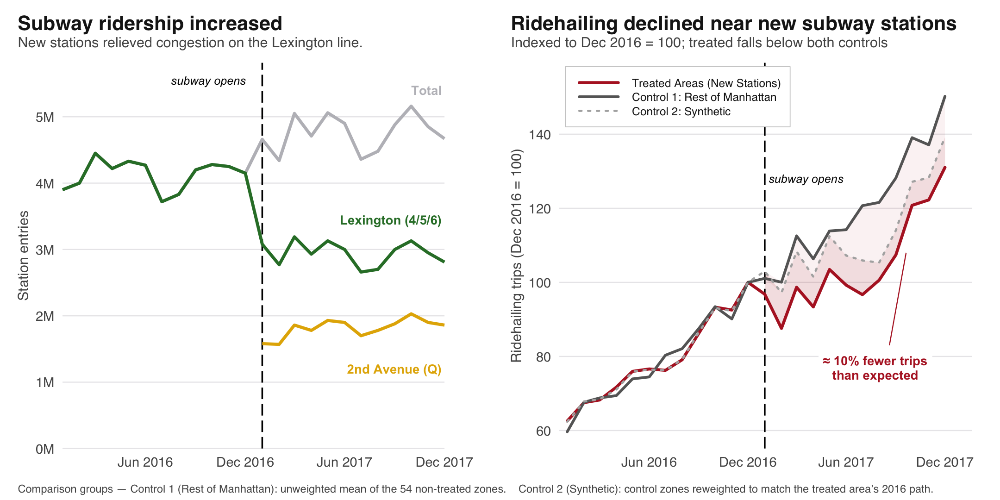
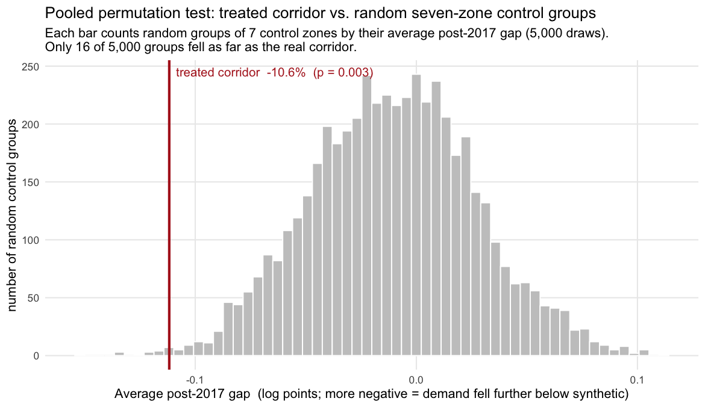

# How did the new Second Avenue Subway impact ride-hailing in NYC?

**A difference-in-differences study of the Q line extension's effect on Uber/Lyft trips in Manhattan, 2016–2017.**

When the Second Avenue Subway (Q line, Phase 1) opened on **1 January 2017**, it gave the
Upper East Side and East Harlem their first new rapid-transit spine since the Lexington Avenue Line opened in 1918. This project asks whether that
new transit capacity pulled riders away from for-hire ride-hailing (Uber/Lyft) in the
corridor it serves — and estimates the size of the substitution.

**Headline result:** ride-hailing demand in the treated corridor fell by **about 10%**
relative to the rest of Manhattan after the line opened. The preferred estimate is
**−10.6%** (a pre-trend-matched synthetic control); estimators range from **−7% to −13%**.

**The story in one chart**

<p align="center">
  
</p>

## Design in one paragraph

Ride-hailing grew rapidly across New York in 2016 and 2017, so a rise in trips near the new
line says little on its own; what matters is how demand changed relative to the rest of the
city. Using monthly ride-hailing trip counts for every Manhattan neighborhood over 2016–2017,
I treat the seven zones along the new line (the Upper East Side and Yorkville corridor) as the
treatment group and the remaining Manhattan zones as controls. A difference-in-differences
design then isolates the change in treated-zone demand after January 2017, net of the city-wide
trend. Because the line opened in all treated zones at once, the design avoids the
staggered-adoption problems (Goodman-Bacon; de Chaisemartin and D'Haultfœuille) that complicate
many recent DiD studies.

<p align="center">
  
</p>

## Headline results

| Estimator | Effect | Notes |
|---|---:|---|
| **Synthetic control, per-zone average (preferred)** | **−10.6%** | near-perfect pre-treatment fit (RMSPE ≈ 0.003) |
| Two-way fixed-effects DiD (61-zone main) | −13.2% | cluster-robust SE 0.055; wild-cluster *p* ≈ 0.06 with only 7 treated zones; ≈ −10k trips/zone/mo |
| TWFE + group-specific linear trend | −9.0% | shrinks but survives |
| Drop month of opening (Dec '16 / Jan '17) | −13.2% / −14.0% | insensitive to the transition month |
| Synthetic control, pooled | −7.0% | conservative floor (plotted below) |
| HonestDiD (relative-magnitudes) | CI stays negative | strict Mbar = 0 bound ≈ [−21%, −6.7%] |

**Honest range: −7% to −13%, central estimate ≈ −10%** — a robust direction, held with moderate
rather than overwhelming statistical confidence (see [Residual & inference diagnostics](#residual--inference-diagnostics)).

**Why these estimators, and why synthetic control leads.** No single number is trusted on its
own — the design triangulates across methods whose assumptions fail in different ways. The
two-way fixed-effects DiD is the conventional workhorse: it absorbs each zone's fixed level and
each month's city-wide shock, which is exactly why it is the right estimator here (subway
proximity is correlated with time-invariant zone traits like income and density, so a
random-effects model would be biased). But it buys identification with a *parallel-trends
assumption* — that the treated corridor would have grown like the Manhattan average absent the
subway. That assumption is untestable after 2017, and the HonestDiD bounds show the −13% TWFE
point estimate sits at the pessimistic edge of what the pre-trends can actually support.

The synthetic control is preferred because it replaces that assumption with a *fit*. Rather than
compare the corridor to the raw control average, it builds a weighted blend of control zones that
reproduces the corridor's 2016 trajectory almost exactly (RMSPE ≈ 0.003) — so the counterfactual
demonstrably tracked the treated group before the line opened, instead of being assumed to. The
per-zone version fits a bespoke synthetic twin for each of the seven treated zones and then
averages, which also respects the fact that those zones differ in income, density, and baseline
ride-hailing levels. Its −10.6% estimate lands between the conservative pooled-synthetic floor
(−7%) and the TWFE upper edge (−13%), which is why it anchors the headline.

### The counterfactual that fits

The treated-zone mean and its synthetic counterfactual track almost perfectly through 2016,
then separate after the line opens in January 2017 — the treated corridor grows more slowly
than its synthetic twin.

<p align="center">
  
</p>

### Parallel trends and the event study

Pre-period event-study coefficients sit on zero (pre-trend slope +0.002 log-pts/mo, p = 0.49),
and every post-period month is negative.

<p align="center">
  
</p>

## Robustness suite

Every check lives in a numbered, runnable script under [`analysis/`](analysis/).

| Check | Script | What it probes |
|---|---|---|
| Main DiD (two-way FE, 61 zones) | `05_did_main_61zones.R` | the headline effect |
| Full model suite (OLS / FE / event study / spatial error models) | `06_models_full_suite.R` | specification and spatial-error sensitivity |
| Pre-trends & parallel-trends diagnostics | `07_pretrends.R` | event study, group trends, month drops |
| HonestDiD (Rambachan–Roth 2023) | `08_honest_did.R` | sensitivity to parallel-trends violations (relative-magnitudes & smoothness) |
| Synthetic control (Abadie, via CVXR) | `09_synthetic_control.R` | design-based counterfactual, pooled and per-zone; placebo/permutation inference and leave-one-out |
| Pooled synthetic-control inference (Cavallo 2013; Dube–Zipperer 2015) | `14_pooled_scm_inference.R` | permutation test on the per-zone-average effect — the estimand that matches the headline |
| Spatial spillover (donut / Butts 2023 ring / SLX) | `10_spatial_spillover.R` | SUTVA / interference from neighboring control zones |
| Hausman / FE-vs-RE (Mundlak-Wu) | `11_hausman.R` | estimator choice, with the degenerate-Hausman explained |
| 52-zone contiguous subset | `12_did_robustness_52zones.R` | a tighter, fully-contiguous spatial subsample |
| Residual diagnostics & honest inference | `13_residual_diagnostics.R` | residuals across the two headline estimators, plus serial-correlation tests, Pesaran CD, Conley spatial-HAC SEs, and a wild cluster bootstrap |

A note on identification: the fixed-effects estimator is correct **by design** here — subway
proximity is correlated with time-invariant zone traits (income, density, land use), so a
random-effects assumption fails. `11_hausman.R` documents why the textbook Hausman test
returns a degenerate p ≈ 1 (all covariates are a single cross-section, so the within estimator
drops them) and replaces it with a balance table, a cluster-robust Mundlak-Wu test (p ≈ 0.07,
leaning FE), and a side-by-side FE/RE comparison (they agree to within 0.5%).

### Residual & inference diagnostics

`13_residual_diagnostics.R` inspects the residuals of the two headline estimators — the per-zone
synthetic control and the 61-zone two-way FE DiD. Residual meaning differs by method: the
fixed-effects residuals have the treatment effect removed (a clean fit shows no structure), while a
synthetic-control residual is `observed − synthetic`, equal to fit error before the opening and the
ATT itself after it.

<p align="center">
  
</p>

By construction the two panels should look different, and they do. With the effect absorbed, the
TWFE residuals scatter around zero in *both* periods — no post-2017 step, so the panel reads as a
serial-correlation check rather than a second parallel-trends test (a role the event study already
fills). The synthetic-control panel behaves oppositely: `treated − synthetic` hugs zero through 2016
(fit error, mean |resid| ≈ 0.016) then steps down to ≈ −0.11 after January 2017 — that step *is* the
estimated effect, not misfit. Neither plot can reveal serial correlation within a zone's own residual
stream, which the formal tests below address.

<p align="center">
  
</p>

Against fitted values the residuals form an even band around zero with a near-flat loess and only
mild level-dependence at low-ridership zone-months — the mild heteroskedasticity the cluster-robust
errors already accommodate. The synthetic-control panel is restricted to the pre-period, the only
window in which its residual reflects fit error rather than the treatment effect.

**The formal tests, and what they imply for the standard errors.** Within-zone serial
correlation is strong, not absent (Wooldridge and Breusch–Godfrey both reject overwhelmingly,
p < 1e-15), which is precisely why the cluster-robust errors are essential rather than cosmetic;
the residuals are also cross-sectionally dependent, and locally so (Pesaran CD z = 6.2 across all
zone pairs, 24.9 among adjacent zones), because the month effects remove city-wide but not
neighborhood-level shocks. The standard error on the −13% TWFE estimate (−0.142 in log points,
the scale the SEs are reported on) therefore turns on how much of that dependence it is allowed to
carry:

| Standard-error method | SE on −0.142 | *p* |
|---|---:|---:|
| naïve i.i.d. (assumes independence) | 0.017 | < 1e-15 |
| Conley spatial-HAC (2 km, 3-month kernel) | 0.029 | 7e-7 |
| cluster by zone | 0.055 | 0.010 |
| wild cluster bootstrap (7 treated zones) | — | 0.058 |

Reading down the table is the story: the more dependence the errors absorb, the wider they get and
the weaker the significance. The Conley errors come out *smaller* than the zone-clustered ones — not
because spatial correlation is negligible, but because the spatial-HAC kernel caps serial dependence
at a few months' lag while zone-clustering lets it run unrestricted across all 24 — so spatial
dependence, though real, is not the binding constraint. What binds is the small number of treated
units: with only seven treated zones the asymptotic cluster-robust p of 0.01 is optimistic, and the
wild cluster bootstrap (Cameron–Gelbach–Miller, null imposed) — the appropriate small-sample test —
puts the 61-zone TWFE at p ≈ 0.06. A leave-one-treated-zone-out jackknife keeps the
TWFE effect between roughly −12% and −18%, so the direction and magnitude are not the fragile part —
the precision is.

**Synthetic-control placebo inference.** For the synthetic control the natural test is not
residual-vs-fitted but a permutation (Abadie, Diamond and Hainmueller 2010): reassigning the
intervention to each control zone in turn and comparing the real corridor's gap to the resulting
placebo distribution. Because the headline is the *per-zone* average effect, the matching inference
pools the seven zones after fitting them separately (Cavallo, Galiani, Noy and Pantano 2013):
average the seven estimated gaps, then compare that average to the gaps from 5,000 random
seven-zone control groups. The −10.6% corridor drop is unlikely to be chance — only sixteen of
those 5,000 groups fell as far (raw-gap permutation p = 0.003). One caveat: tests that reward a zone
for an unusually *steady* pre-period are more equivocal (RMSPE-ratio and Dube–Zipperer rank both
p ≈ 0.11–0.12), because the treated zones were ordinary rather than especially calm beforehand; the
corridor's strength is the size and consistency of its drop, not an exceptionally quiet baseline. Leave-one-out tells the same story. The per-zone −10.6% average is stable when any single
treated zone is dropped (−9.4% to −11.9%), though the underlying per-zone effects range widely, from
about −2% at the corridor ends (East Harlem South, Upper East Side South) to −14% to −17% in the
Yorkville and Lenox Hill West zones that sit on the new 72nd-, 86th- and 96th-Street stations.

<p align="center">
  
</p>

## Repository layout

```
.
├── data/                     raw inputs
│   ├── 2016sum.csv           monthly ride-hailing counts by taxi zone, 2016
│   ├── 2017sum.csv           monthly ride-hailing counts by taxi zone, 2017
│   └── MN.csv                NYC PLUTO land-use records (Manhattan)
├── analysis/
│   ├── 00_map_treatment.R    treatment-vs-control map
│   ├── 01_build_ridehailing.R … 14_pooled_scm_inference.R
│   ├── *.rds                 committed checkpoints (lets you skip the rebuild)
│   ├── *.png                 figures
│   ├── *.csv                 result tables
│   └── geo/                  TLC taxi-zone shapefile
└── docs/
    └── summary.pdf           one-page plain-language summary
```

## Reproducing the results

All scripts are run **from the repository root** and read the committed checkpoints in
`analysis/`, so you can reproduce every model and figure without re-downloading any external
data:

```bash
Rscript analysis/05_did_main_61zones.R      # headline DiD
Rscript analysis/07_pretrends.R             # event study + parallel-trends figures
Rscript analysis/09_synthetic_control.R     # synthetic control + placebo inference
Rscript analysis/10_spatial_spillover.R     # spillover-robust DiD
Rscript analysis/08_honest_did.R            # HonestDiD bounds (needs the HonestDiD package)
Rscript analysis/13_residual_diagnostics.R  # residual + inference diagnostics (Conley, wild bootstrap)
Rscript analysis/14_pooled_scm_inference.R  # pooled SCM permutation (Cavallo 2013) on the per-zone-average effect
```

To rebuild the data pipeline from the raw inputs instead of the checkpoints, set a Census API
key and run the build scripts in order:

```bash
export CENSUS_API_KEY=your_key_here         # census.gov/data/developers
Rscript analysis/01_build_ridehailing.R     # clean trip counts (corrects a TLC data defect)
Rscript analysis/02_build_census.R          # ACS demographics -> taxi zones
Rscript analysis/03_build_landuse.R         # PLUTO land use -> taxi zones
Rscript analysis/04_build_sample_and_weights.R  # 61-zone sample + spatial weights
```

### A data-quality note

The published NYC TLC November-2017 for-hire-vehicle trip file duplicated whole daily batches,
inflating every taxi zone's count by roughly 1.45×. `01_build_ridehailing.R` de-duplicates
November 2017 against the independently-reported dispatch totals and retains the (clean)
December 2017 holiday peak. This correction is applied before any modeling.

## Software

R, with `plm`, `spdep`, `splm`, `sandwich`, `lmtest`, `HonestDiD`, `CVXR`, `sf`, `tidycensus`,
`tigris`, `dplyr`, and `ggplot2`.

---

*A one-page, plain-language summary of this project is in [`docs/summary.pdf`](docs/summary.pdf).*
